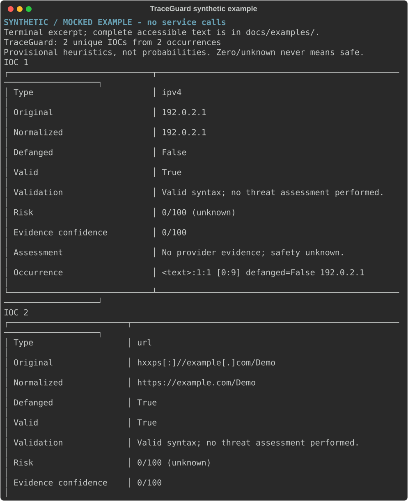
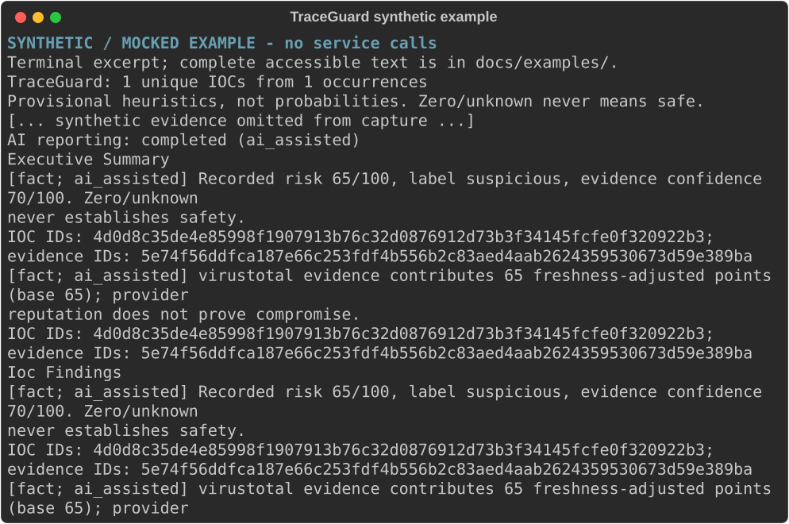

# TraceGuard

A Python 3.12 CLI for SOC analysts and students investigating indicators of
compromise. It extracts and normalizes IOCs, optionally retrieves existing threat
intelligence, computes explainable deterministic assessments, and optionally uses
Groq to select evidence-grounded report claims.

This is an early MVP, not a production detection system. The core can be reused by
a future web API; no website, persistence, accounts or automated remediation exists.
Repository URL: [Salah-f4/TraceGuard](https://github.com/Salah-f4/TraceGuard) (provisional).

## Quick start on Windows

Run in the project directory. Activation is unnecessary; no PowerShell policy change
is required. Keep any existing `.venv` unchanged. Do not recreate `.venv312` if it
already exists; first verify that its interpreter is Python 3.12.

```powershell
py -3.12 -m venv .venv312
.\.venv312\Scripts\python.exe -m pip install --require-hashes -r requirements/windows-py312-tooling.txt
.\.venv312\Scripts\python.exe -m pip install --require-hashes -r requirements/windows-py312-dev.txt
.\.venv312\Scripts\python.exe -m pip install --no-deps --no-build-isolation -e .
.\.venv312\Scripts\traceguard.exe analyze --text "192.0.2.1 hxxps[:]//example[.]com/Demo" --format json
```

The example is offline and uses reserved documentation indicators. Linux lockfiles
are resolved for Python 3.12; see [validation status](docs/phase6-validation.md)
for the distinction between resolution and native execution.

## Capabilities and privacy

| Mode | Behavior | External disclosure |
| --- | --- | --- |
| Default | Extract, normalize, deduplicate and assess; schema 1.2 | None |
| `--enrich` | Existing reports from VirusTotal, AbuseIPDB and URLhaus | Only eligible normalized IOCs |
| `--ai` without citable evidence | Schema 1.3 deterministic fallback | None |
| `--enrich --ai` | Optional Groq selection of vetted claims | Compact numeric/enum facts and temporary aliases |

Supports IPv4/IPv6, domains, hierarchical URLs, email, MD5/SHA-1/SHA-256 and common
defanging (`hxxp`, `hxxps`, `[.]`, `(.)`, `[:]`). Original values and occurrences are
retained locally. Maximum input: 1,000,000 bytes; maximum extracted occurrences:
10,000 before deduplication. Limits fail explicitly without truncation.

No file uploads, scan submissions, DNS lookups, URL visits, downloads, execution or
remediation. Provider connections themselves require normal transport networking.
Private/reserved IPs and email indicators are never sent to intelligence services.
URLs with credentials or query strings are skipped; lookup fragments are removed.

## Usage

```powershell
.\.venv312\Scripts\traceguard.exe --help
.\.venv312\Scripts\traceguard.exe analyze --file tests/fixtures/mixed.log
Get-Content -Raw tests/fixtures/mixed.log | .\.venv312\Scripts\traceguard.exe analyze --stdin
New-Item -ItemType Directory -Force reports | Out-Null
.\.venv312\Scripts\traceguard.exe analyze --file tests/fixtures/mixed.log --format json --output reports/example.json
.\.venv312\Scripts\traceguard.exe analyze --text "192.0.2.1" --ai --format json
```

Use exactly one of `--text`, `--file`, `--stdin`. Input files must be UTF-8 `.txt`
or `.log` (optional BOM). Prefer `--file` for international text because PowerShell
pipeline encoding varies; in cmd.exe use `type sample.log | ... analyze --stdin`.
Create the output directory first. Existing output files are never overwritten.
Report data goes to stdout, warnings/errors to stderr. Input/export errors exit 2;
cancellation exits 130. Optional provider/AI failure retains a report and can exit 0.
Export destinations are checked after enrichment and before the AI request.

Add `--enrich` and optionally `--ai` only when you intend external disclosure and
have reviewed provider terms. These options are never exercised live by tests.
Reserved demonstration IOCs are intentionally skipped by the enrichment policy.

## Reports and AI fallback

Scores 0–100 and separate evidence confidence are provisional heuristics, not
probabilities. Labels are unknown, low, suspicious and malicious. Zero, not_found,
harmless votes or no adverse evidence **never establish safety**. Provider failures
do not change risk/confidence. Full evidence attribution and scoring breakdowns
remain in both terminal and JSON reports. Relationships are descriptive only.

AI uses Groq `qwen/qwen3.8-27b`, strict JSON, no tools/streaming/actions, at most
4,000 input and 1,000 output tokens. It returns one flat list of claim aliases;
TraceGuard validates ownership, mandatory claims, duplicates and limits, then routes
and renders wording locally. AI cannot change deterministic findings. Unavailable configuration,
privacy or budget limits, refusal or validation failure preserve complete local fallback.
Only codes, counts and numeric token estimates are diagnostic data; raw model output
is not saved. Local exported reports still contain source/evidence: protect them.

## Configuration

`.env.example` lists four blank names. Set them in your environment or a locally
created, ignored `.env`; never commit values. Do not overwrite an existing `.env`.
Environment variables take precedence, even explicit blanks. Loading uses only the
current directory, UTF-8/BOM, no interpolation or parent-directory search. Missing
keys disable optional providers. Offline operation does not read the file.

Groq provider/model defaults are pinned; optional TRACEGUARD_AI_PROVIDER and
TRACEGUARD_AI_MODEL settings must match them. API keys never belong in command-line
arguments, screenshots, diagnostics, tests or Git. See [provider terms](docs/provider-terms.md).

## Examples and architecture

The following captures are synthetic, generated without any service calls. They are
not real intelligence about the illustrated indicators.




[Accessible examples](docs/examples/README.md) · [Architecture](docs/architecture.md)
· [Product contract](docs/product.md)

## Development and limitations

[Testing and locked builds](docs/testing.md) · [Latest local validation](docs/phase6-validation.md)
· [Release checklist](docs/release-checklist.md) · [Contributing](CONTRIBUTING.md)

Extraction can confuse dotted filenames with domains; quoted/international email
local parts, scoped IPv6, relative URLs and public-suffix validation are unsupported.
Intelligence may be stale, incomplete, conflicting or derived from common upstream
sources. Conservative AI accounting can skip large reports. AI selects existing
claims; it creates no new hypotheses. Protect sensitive local input and exports.
Use only data you are authorized to investigate. No guarantee of compromise detection
or safety is made. See [known boundaries](docs/product.md).

## License and security

MIT, copyright © 2026 Salahuddin Alrowaili. See [LICENSE](LICENSE). Provider services
and data have separate terms; notably VirusTotal Public API is non-commercial.
Use [SECURITY.md](SECURITY.md) for GitHub private vulnerability reporting after the
owner enables it. No personal email is published. No hosted CI success, published
package or repository creation is claimed by this working tree.
