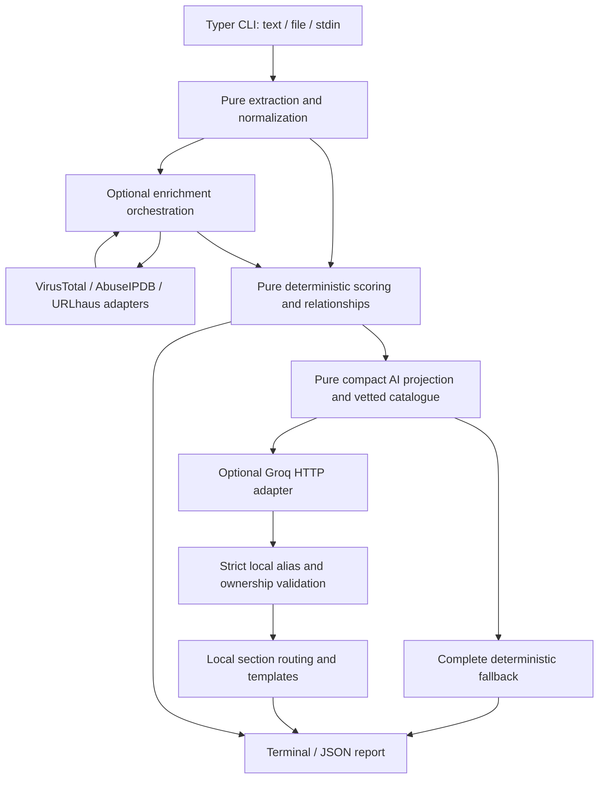

# Architecture

Only HTTP adapters cross network boundaries and only after explicit opt-in.
CLI input/rendering and credential loading stay outside the pure core. No core
module depends on CLI argument parsing, filesystem storage or an HTTP client.
Existing report contracts allow later API reuse, without implementing a web layer.

## Boundaries and data contracts

src/traceguard/core contains extraction/models, eligibility, provider-neutral ports,
assessment/scoring/correlation and AI projection/validation. adapters/cli owns
Typer/Rich input/output. adapters/intelligence owns fixed report endpoints and
HTTP resilience. bootstrap composes intelligence clients. ai_service composes the
provider-neutral AI port with the Groq adapter; ai_config reads only AI configuration.

AnalysisReport is offline provenance. EnrichedReport adds independent provider
outcomes and coverage. AssessedReport/AssessedEnrichedReport add policy-versioned
risk, confidence, evidence references and descriptive relationships (schema 1.2).
AIReport adds separate ai_reporting (schema 1.3); all deterministic fields remain
identical before/after the optional layer. Scoring uses explicit UTC as-of time.

The outbound AI wire projection contains aliases, allowed numeric/enum facts,
coarse freshness, uncertainty flags and a compact claim/template catalogue.
Internal hashed IDs, JSON pointers, timestamps, occurrences, source locations,
raw provider text and IOC values remain local. The strict response contains only
claims: [C1, C2, ...]. Immutable local catalogue destinations assign sections.
Validation rebuilds ownership/predicates, rejects global duplicates and unknown
aliases, requires mandatory uncertainties and section coverage, and enforces count
limits. Wording and action priority are local; no model prose or command runs.

No long-term response storage/cache/database exists. .env loading is opt-in, scoped
to cwd with environment precedence; exports are explicit local files. Test/build
artifacts are separate from release files. Protected local files are never copied
into release candidates. Tests block networking and use mocked transports; installed
wheel smoke has its own network/process guard. See testing.md for exact commands.

## Current policies and version history

phase4-plan.md retains the unchanged scoring specification. phase5-plan.md and
phase5-validation.md contain dated design/validation history; later compact/flat
routing revisions supersede the earlier sectioned-output proposals. The current
behavior is summarized above and in product.md. phase6-plan.md is the approved
release preparation scope, with actual outcomes in phase6-validation.md. No website,
authentication, persistence or new providers are introduced by this phase.
